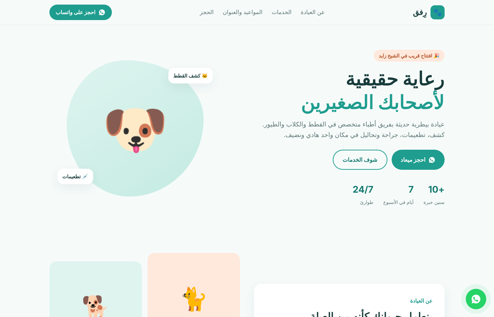

# Vet Clinic Landing Page (Demo)

A one-page, Arabic (RTL) landing page for a fictional veterinary clinic, **رِفق**.

**Live demo:** https://saifaboalnaga.github.io/vet-clinic-landing-demo/



## Sections
- Hero with clinic intro and a WhatsApp booking button
- About the clinic
- Services: check-ups, vaccinations, surgery, lab tests and X-ray, grooming, emergency
- Working hours (today is highlighted, with a live open/closed badge) and address with a Google Maps link
- Booking form that opens WhatsApp with a ready-made message (name, pet type, service, preferred day)
- Floating WhatsApp button on every screen

## Tech
Plain HTML, CSS and JavaScript in a single `index.html`. No frameworks, no build step. Fully responsive, with soft scroll animations (disabled for users who prefer reduced motion).

## Customize
At the top of the `<script>` in `index.html`:

```js
const WHATSAPP_NUMBER = "201000000000";  // clinic WhatsApp, digits only
const MAP_QUERY = "Sheikh Zayed, Giza";   // address for Google Maps
const HOURS = { open: 10, close: 22, fridayOpen: 14 };
```

Text, services and colors (CSS variables in `:root`) can be edited directly in the file.

> The clinic, address and phone number are fictional. This is a portfolio demo.
